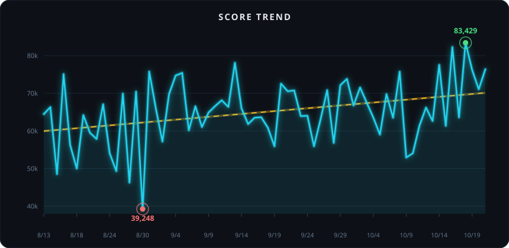
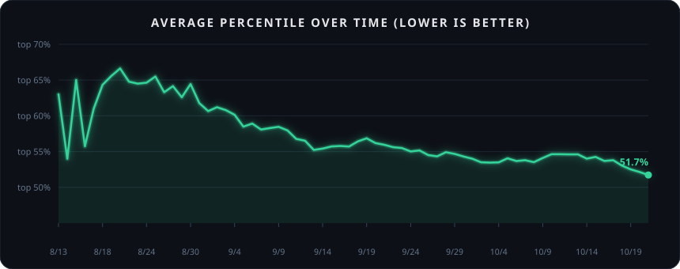
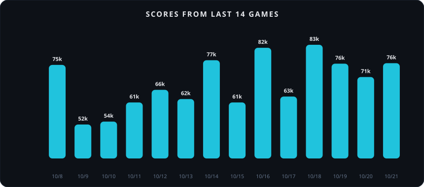
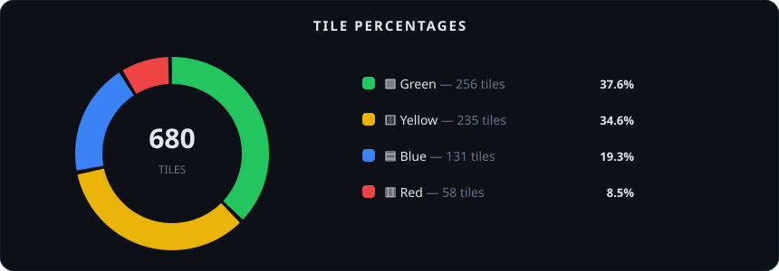

### Avg score: **65,042** · Best score: **83,429** · Best percentile: **top 5%**

## Personal bests

| # | Date | Tiles | Score | Percentile |
|:-:|:-----|:------|------:|:----------:|
| 1 | Oct 18 | 🟩🟦🟦🟩🟦🟦🟦🟨🟩🟨 | **83,429** | top 5% |
| 2 | Oct 16 | 🟨🟨🟨🟦🟦🟦🟩🟦🟦🟦 | **82,268** | top 19% |
| 3 | Sep 13 | 🟦🟦🟥🟩🟦🟦🟩🟩🟩🟦 | **78,080** | top 18% |
| 4 | Oct 14 | 🟩🟦🟩🟩🟨🟨🟦🟩🟩🟦 | **77,522** | top 18% |
| 5 | Oct 21 | 🟦🟦🟦🟩🟦🟩🟩🟩🟥🟩 | **76,391** | top 23% |

---

## The trail

*Best: 83,429 on Oct 18 (top 5%) · Worst: 39,248 on Aug 30 · Average: 65,042 · Range: 44,181.*

*Avg percentile: top 52% · Peak: top 66% in late August.*

---

## Recent form

*All-time average: 65,042 · Median: 66,013.*

---

## Month by month

| Month | Games | Avg Score | Best | Worst | Avg Percentile |
|:------|:-----:|----------:|------|-------|---------------:|
| Aug 2026 | 17 | 59,680 | 75,763 (`8_31`) | 39,248 (`8_30`) | top 62% |
| Sep 2026 | 30 | 66,050 | 78,080 (`9_13`) | 55,950 (`9_19`) | top 50% |
| Oct 2026 | 21 | 67,942 | 83,429 (`10_18`) | 52,961 (`10_9`) | top 46% |

---

## Artifact breakdown

---

## Game log

All 68 games

| Date | Tiles | Score | Percentile |
|:-----|:------|------:|:----------:|
| Aug 13 | 🟨🟨🟩🟩🟨🟩🟨🟦🟨🟩 | 64,497 | top 63% |
| Aug 14 | 🟨🟨🟦🟦🟩🟨🟩🟦🟩🟨 | 66,309 | top 45% |
| Aug 15 | 🟩🟩🟨🟨🟩🟨🟥🟥🟨🟩 | 48,569 | top 87% |
| Aug 16 | 🟩🟨🟨🟩🟩🟩🟩🟨🟩🟦 | 75,078 | top 28% |
| Aug 17 | 🟨🟥🟨🟨🟦🟨🟩🟨🟨🟦 | 56,316 | top 82% |
| Aug 18 | 🟨🟨🟨🟨🟩🟦🟨🟥🟨🟨 | 50,037 | top 81% |
| Aug 20 | 🟩🟨🟩🟩🟩🟥🟨🟦🟩🟩 | 64,181 | top 73% |
| Aug 21 | 🟨🟩🟩🟨🟨🟦🟨🟩🟨🟨 | 59,541 | top 74% |
| Aug 22 | 🟥🟥🟨🟩🟨🟨🟦🟩🟩🟩 | 57,891 | top 50% |
| Aug 23 | 🟦🟩🟨🟨🟨🟨🟩🟩🟦🟨 | 67,070 | top 62% |
| Aug 24 | 🟩🟨🟨🟩🟩🟩🟨🟨🟨🟨 | 54,082 | top 66% |
| Aug 25 | 🟨🟩🟩🟩🟥🟨🟨🟨🟥🟨 | 49,359 | top 75% |
| Aug 26 | 🟩🟩🟨🟦🟦🟩🟩🟨🟨🟨 | 69,883 | top 37% |
| Aug 27 | 🟨🟩🟥🟨🟥🟩🟨🟨🟩🟥 | 46,314 | top 75% |
| Aug 29 | 🟩🟥🟦🟩🟨🟩🟨🟩🟦🟩 | 70,427 | top 41% |
| Aug 30 | 🟥🟩🟥🟥🟨🟨🟦🟥🟨🟥 | 39,248 | top 92% |
| Aug 31 | 🟦🟦🟦🟩🟩🟨🟦🟩🟨🟨 | 75,763 | top 19% |
| Sep 1 | 🟩🟨🟨🟩🟦🟨🟨🟨🟩🟦 | 66,013 | top 42% |
| Sep 2 | 🟩🟨🟥🟥🟦🟩🟨🟩🟩🟨 | 57,221 | top 71% |
| Sep 3 | 🟨🟨🟦🟥🟩🟦🟩🟩🟩🟩 | 69,801 | top 53% |
| Sep 4 | 🟦🟦🟨🟩🟨🟨🟦🟩🟨🟩 | 74,700 | top 47% |
| Sep 5 | 🟦🟦🟩🟩🟩🟦🟩🟥🟨🟩 | 75,404 | top 24% |
| Sep 6 | 🟨🟦🟩🟩🟨🟨🟩🟩🟨🟥 | 60,210 | top 68% |
| Sep 7 | 🟩🟩🟩🟨🟩🟨🟦🟦🟩🟥 | 66,528 | top 39% |
| Sep 8 | 🟦🟨🟨🟨🟨🟥🟩🟨🟦🟦 | 61,073 | top 63% |
| Sep 9 | 🟩🟥🟩🟨🟩🟦🟨🟨🟩🟦 | 64,901 | top 63% |
| Sep 10 | 🟩🟥🟨🟩🟩🟩🟨🟦🟦🟨 | 66,608 | top 45% |
| Sep 11 | 🟩🟥🟨🟩🟩🟦🟦🟨🟦🟨 | 68,150 | top 25% |
| Sep 12 | 🟩🟩🟨🟨🟩🟨🟦🟩🟩🟥 | 66,405 | top 49% |
| Sep 13 | 🟦🟦🟥🟩🟦🟦🟩🟩🟩🟦 | 78,080 | top 18% |
| Sep 14 | 🟩🟦🟨🟨🟩🟨🟨🟦🟥🟦 | 66,024 | top 61% |
| Sep 15 | 🟩🟩🟩🟨🟨🟨🟦🟨🟨🟨 | 61,856 | top 65% |
| Sep 16 | 🟩🟦🟨🟦🟩🟦🟨🟥🟨🟩 | 63,514 | top 58% |
| Sep 17 | 🟥🟩🟩🟩🟨🟨🟦🟨🟨🟦 | 63,646 | top 53% |
| Sep 18 | 🟨🟩🟨🟩🟨🟩🟩🟨🟩🟩 | 60,865 | top 81% |
| Sep 19 | 🟥🟨🟥🟦🟨🟩🟨🟩🟨🟩 | 55,950 | top 72% |
| Sep 20 | 🟩🟩🟨🟩🟩🟦🟩🟨🟩🟨 | 72,557 | top 32% |
| Sep 21 | 🟩🟦🟩🟦🟨🟩🟩🟨🟨🟨 | 70,570 | top 47% |
| Sep 22 | 🟩🟦🟥🟨🟦🟩🟩🟩🟨🟩 | 70,754 | top 43% |
| Sep 23 | 🟩🟨🟨🟥🟨🟩🟩🟦🟩🟦 | 63,964 | top 51% |
| Sep 24 | 🟩🟥🟩🟩🟨🟩🟦🟩🟨🟥 | 64,040 | top 36% |
| Sep 25 | 🟨🟨🟨🟩🟨🟨🟥🟩🟦🟩 | 55,964 | top 61% |
| Sep 26 | 🟦🟩🟩🟩🟩🟨🟨🟩🟥🟨 | 63,084 | top 27% |
| Sep 27 | 🟩🟦🟨🟩🟨🟥🟦🟦🟦🟨 | 70,821 | top 47% |
| Sep 28 | 🟨🟦🟨🟨🟨🟨🟩🟩🟨🟨 | 56,855 | top 80% |
| Sep 29 | 🟨🟦🟩🟩🟨🟦🟨🟦🟦🟨 | 72,133 | top 44% |
| Sep 30 | 🟨🟦🟨🟦🟨🟩🟩🟦🟨🟦 | 73,804 | top 38% |
| Oct 1 | 🟨🟩🟨🟨🟩🟨🟩🟩🟨🟦 | 66,805 | top 39% |
| Oct 2 | 🟩🟦🟦🟩🟨🟩🟩🟩🟨🟨 | 71,524 | top 30% |
| Oct 3 | 🟩🟩🟩🟨🟩🟨🟩🟨🟨🟦 | 67,521 | top 51% |
| Oct 4 | 🟩🟩🟦🟩🟦🟨🟨🟥🟩🟨 | 63,579 | top 55% |
| Oct 5 | 🟦🟨🟥🟩🟩🟥🟥🟩🟦🟩 | 59,068 | top 83% |
| Oct 6 | 🟩🟦🟩🟥🟦🟩🟨🟩🟩🟨 | 69,744 | top 34% |
| Oct 7 | 🟨🟩🟩🟩🟨🟩🟦🟩🟨🟥 | 63,537 | top 60% |
| Oct 8 | 🟩🟦🟩🟩🟦🟨🟨🟩🟩🟩 | 75,732 | top 39% |
| Oct 9 | 🟨🟦🟩🟨🟥🟥🟥🟩🟨🟩 | 52,961 | top 86% |
| Oct 10 | 🟦🟨🟥🟩🟨🟨🟥🟩🟨🟩 | 54,075 | top 84% |
| Oct 11 | 🟩🟨🟩🟥🟨🟩🟨🟩🟦🟩 | 61,399 | top 55% |
| Oct 12 | 🟩🟩🟨🟨🟩🟨🟩🟩🟨🟦 | 66,202 | top 53% |
| Oct 13 | 🟥🟨🟦🟩🟦🟨🟩🟩🟨🟩 | 62,680 | top 55% |
| Oct 14 | 🟩🟦🟩🟩🟨🟨🟦🟩🟩🟦 | 77,522 | top 18% |
| Oct 15 | 🟨🟩🟦🟨🟨🟩🟩🟨🟩🟨 | 61,393 | top 69% |
| Oct 16 | 🟨🟨🟨🟦🟦🟦🟩🟦🟦🟦 | 82,268 | top 19% |
| Oct 17 | 🟦🟦🟨🟩🟦🟨🟥🟥🟨🟩 | 63,639 | top 60% |
| Oct 18 | 🟩🟦🟦🟩🟦🟦🟦🟨🟩🟨 | 83,429 | top 5% |
| Oct 19 | 🟩🟦🟩🟩🟩🟩🟩🟩🟩🟩 | 76,205 | top 18% |
| Oct 20 | 🟨🟩🟨🟦🟨🟦🟦🟨🟨🟦 | 71,104 | top 28% |
| Oct 21 | 🟦🟦🟦🟩🟦🟩🟩🟩🟥🟩 | 76,391 | top 23% |

---

*Charts: `generate_charts.py` → `assets/cool/`. The auto-generated stats dump lives in `README_old.md`.*
